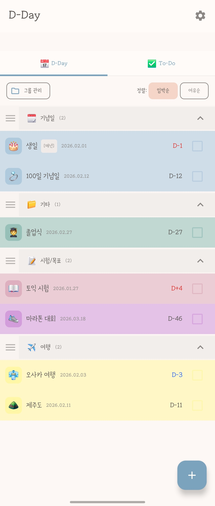
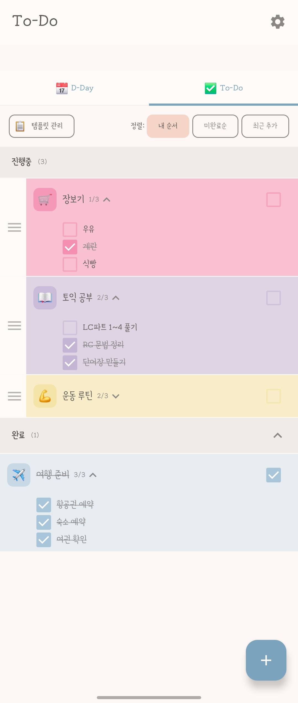
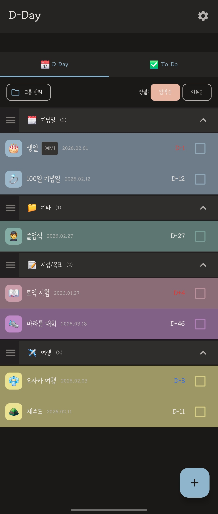
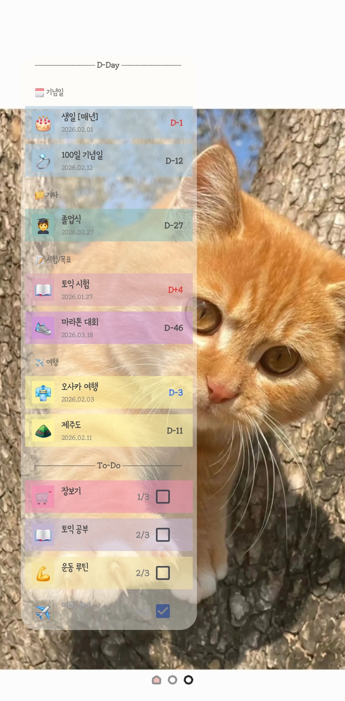
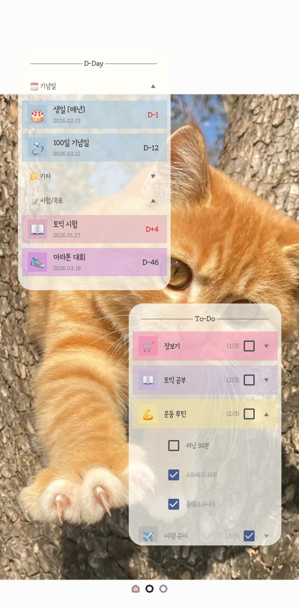
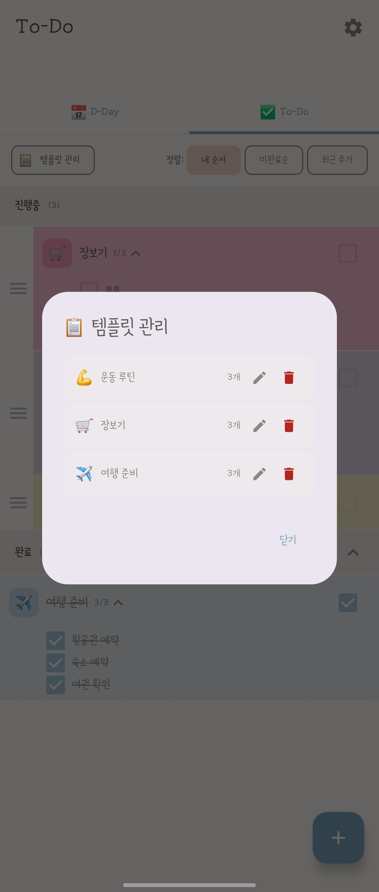

<div align="center">

[English](README.md) | **한국어**

# 📅 Dayli

**D-Day 카운트다운 & To-Do 체크리스트 — 홈 화면에서 항상 확인하세요**

*잊지 않으려면, 항상 보이게.*

[](https://developer.android.com)
[](https://kotlinlang.org)
[](https://developer.android.com/jetpack/compose)
[](https://play.google.com/store/apps/details?id=com.silverwest.dayli)

</div>

---

## 📱 스크린샷

<div align="center">
<table>
  <tr>
    <td align="center"><b>D-Day 탭</b></td>
    <td align="center"><b>To-Do 탭</b></td>
    <td align="center"><b>다크 모드</b></td>
  </tr>
  <tr>
    <td></td>
    <td></td>
    <td></td>
  </tr>
  <tr>
    <td align="center"><b>혼합 위젯</b></td>
    <td align="center"><b>개별 위젯</b></td>
    <td align="center"><b>템플릿 관리</b></td>
  </tr>
  <tr>
    <td></td>
    <td></td>
    <td></td>
  </tr>
</table>
</div>

---

## ✨ 주요 기능

### D-Day 카운트다운
- 중요한 날짜를 등록하고 남은 일수 확인 (D-3~D-2 파란색 / D-1, D-Day, D+N 빨간색)
- 시간 설정 가능 (예: 오후 2시 30분)
- 메모 필드로 장소, 참고사항 등 부가 정보 기록
- 그룹별 분류, 그룹 드래그 순서 변경
- 그룹 관리: 이름 변경, 삭제, 그룹별 이모지 설정
- 임박순/여유순 정렬
- 반복 일정: 매일/매주(요일 선택)/매월/매년
- 미리 표시 일수 설정 (예: 2주 전, 1달 전부터 표시)
- 체크한 반복 항목은 자동 숨김 → 다음 발생일에 자동 복귀
- 캘린더 뷰로 월별 D-Day 한눈에 확인

### 개별 알림
- 항목별 맞춤 알림 규칙 설정
- 일 단위: 1일/3일/7일/14일/30일 전
- 시간 단위: 10분/30분/1시간/2시간 전 (시간 설정된 항목)
- D-1, D-Day 전체 푸시 알림 (알림 시간, 소리, 진동 설정 가능)

### AI 자동 입력
- 캡처 이미지·텍스트·음성으로 일정 자동 추출 (Gemini, Firebase AI Logic 경유)
- AI가 캡처에서 과목명·교수명·마감 시간을 읽어 일정 입력을 도와줌 (기기 OCR을 거치지 않고 이미지를 직접 분석)
- 학교 일정: LMS 목록은 활동별, 시험 시간표는 교시별로 D-Day를 한 번에 만들고 기존 학교 그룹(없으면 '학교' 그룹)으로 자동 정리
- 자정(00:00) 마감은 전날 23:59로 보정, 긴 스크롤 캡처는 나눠서 분석
- 레시피, 쇼핑 목록, 약속 대화 등 다양한 형식 지원
- 여러 일정 한 번에 일괄 등록, 내용에 맞는 이모지 자동 추천

### To-Do 체크리스트
- 하위 항목까지 세분화해서 관리
- 하위 항목 전체 완료 시 자동 체크
- 템플릿 저장 & 불러오기
- 진행률 한눈에 확인 (2/5 등)
- 드래그로 순서 변경
- 내 순서 / 미완료순 / 최근 추가 정렬
- 반복 일정: 매일/매주(요일 선택)/매월/매년

### 공유 & 내보내기
- 텍스트 공유: 이모지 + D-Day 카운트다운 형식
- 이미지 공유: 색상 카드 스타일 PNG 이미지 생성
- 날짜별 D-Day 묶어서 공유
- To-Do 공유 시 진행률 바 포함

### 홈 화면 위젯
- **혼합 위젯** — D-Day와 To-Do를 함께 표시
- **D-Day 전용 위젯** — 날짜 추적에 집중
- **To-Do 전용 위젯** — 빠른 할 일 체크
- 위젯에서 바로 체크 가능
- 그룹 접기/펼치기 지원
- 글씨 크기, 배경 투명도 커스터마이징

### 커스터마이징
- 유니코드 이모지 약 1,900개 (기기에 따라 표시 개수가 다를 수 있음): 한글 검색, 최근 사용, 일정용 추천 모음, 피부색
- 제목에 맞는 이모지 자동 추천 (치과 예약 → 🦷)
- 이모지 스타일: 기본 / 플랫 (Microsoft Fluent Emoji, 앱·위젯·공유 이미지 적용)
- 14가지 파스텔 색상 팔레트
- 테마 모드: 시스템 설정 / 라이트 / 다크
- 앱 & 위젯 글씨 크기 조절 (작게 / 보통 / 크게)
- 아이템 배경, 아이콘 배경, 위젯 배경 투명도 개별 설정
- 당겨서 새로고침 (Pull-to-Refresh)
- UI 상태 저장: 마지막 탭, 섹션 펼침/접힘, 하위 체크리스트 펼침 상태

---

## 🛠 기술 스택

| 분류 | 기술 |
|------|------|
| **언어** | Kotlin |
| **UI 프레임워크** | Jetpack Compose |
| **아키텍처** | MVVM |
| **로컬 DB** | Room |
| **위젯** | RemoteViews + AppWidgetProvider |
| **비동기 처리** | Kotlin Coroutines + LiveData |
| **AI** | Google Gemini (Firebase AI Logic + App Check) |
| **광고** | Google AdMob |
| **Min SDK** | 24 (Android 7.0) |
| **Target SDK** | 35 (Android 15) |

---

## 🏗 아키텍처

```
com.silverwest.dayli
├── MainActivity.kt                  # 앱 진입점
├── ui/theme/                        # 앱 테마 (Color, Theme, Type)
└── ddaywidget/
    ├── DdayScreen.kt               # 메인 화면 (D-Day + To-Do 탭)
    ├── DdayListItem.kt             # 리스트 아이템 컴포저블
    ├── AddEditBottomSheet.kt       # 추가/수정 바텀시트
    ├── SettingsScreen.kt           # 설정 화면
    ├── DdayItem.kt                 # Room 엔티티
    ├── DdayDao.kt                  # Room DAO
    ├── DdayDatabase.kt             # Room 데이터베이스 (v15, 15개 마이그레이션)
    ├── DdayViewModel.kt            # ViewModel
    ├── DdaySettings.kt             # SharedPreferences 헬퍼
    ├── DdayWidgetProvider.kt       # 혼합 위젯 프로바이더
    ├── DdayOnlyWidgetProvider.kt   # D-Day 전용 위젯 프로바이더
    ├── TodoOnlyWidgetProvider.kt   # To-Do 전용 위젯 프로바이더
    ├── NotificationHelper.kt       # 알림 채널 & 전달
    ├── NotificationScheduler.kt    # 알림 스케줄링
    ├── NotificationReceiver.kt     # 브로드캐스트 리시버
    ├── BootReceiver.kt             # 부팅 시 알림 재등록
    ├── GeminiParser.kt              # Gemini AI 파싱 래퍼
    ├── DdayCalendarView.kt         # 캘린더 뷰
    ├── DdayShareHelper.kt          # 공유 (텍스트/이미지)
    ├── EmojiPickerDialog.kt        # 시스템 이모지 피커
    ├── TodoTemplate.kt             # 템플릿 엔티티 & DAO
    └── ...                         # Enum, 컨버터, 유틸리티
```

**MVVM 패턴**을 따르며 ViewModel이 Room DAO를 직접 호출합니다. Room 데이터베이스로 로컬 데이터를 관리하고, LiveData로 앱과 위젯 간 반응형 데이터 업데이트를 구현했습니다.

---

## 🔑 주요 기술적 도전

### 위젯 ↔ 앱 양방향 동기화
앱과 홈 화면 위젯 간 양방향 동기화를 구현했습니다. 앱에서의 변경이 위젯에 즉시 반영되고, 위젯에서의 체크박스 조작이 `AppWidgetManager.notifyAppWidgetViewDataChanged()`를 통해 실시간으로 앱 데이터베이스에 반영됩니다.

### 위젯 내 접기/펼치기 그룹
`RemoteViews`는 Compose에 비해 레이아웃 기능이 제한적이지만, 그 안에서 커스텀 접기/펼치기 그룹 헤더를 구현했습니다. 위젯 업데이트 간에도 펼침/접힘 상태가 유지되도록 관리했습니다.

### 이모지 카탈로그 & 플랫 스타일
유니코드 15.1 이모지와 CLDR 한국어 키워드로 자체 카탈로그를 만들어 한글 검색과 제목 기반 이모지 추천을 오프라인으로 구현했습니다. 기기가 그릴 수 없는 이모지는 걸러내고, 플랫 스타일(Fluent Emoji)은 데이터를 표준 이모지 문자로 유지한 채 Compose와 위젯(RemoteViews ImageView)에서 표시만 이미지로 바꿉니다.

### 템플릿 시스템
자주 사용하는 체크리스트 구조를 저장하고 한 번의 탭으로 빠르게 재생성할 수 있는 To-Do 템플릿 저장/불러오기 시스템을 설계했습니다.

### AI 자연어·이미지 파싱 (Gemini)
Firebase AI Logic을 통해 Gemini에 이미지를 직접 보내 일정을 추출합니다(Gemini API 키를 앱에 직접 내장하지 않음, App Check로 정품 앱만 호출). 기기 OCR 단계에서 생기던 과목명·교수명 오인식을 줄였고, 사용자의 기존 그룹 목록을 함께 보내 학교 일정을 알맞은 그룹으로 정리합니다. 시험 시간표는 교시 단위로 그룹화하고, 레시피는 재료를 하위 항목으로, 쇼핑 목록은 품목만 추출하는 등 맥락별 최적화된 프롬프트 엔지니어링을 적용했습니다.

### 이미지 공유 카드 생성
D-Day와 To-Do 항목을 카드 스타일 PNG 이미지로 변환하여 공유하는 기능을 구현했습니다. Canvas API로 둥근 모서리, 배경 색상에 따른 자동 텍스트 색상 조정, 진행률 바 등을 렌더링합니다.

---

## 📦 빌드 & 실행

```bash
# 레포지토리 클론
git clone https://github.com/esheo1787/Dayli.git

# Android Studio에서 열기
# 에뮬레이터 또는 실기기에서 빌드 및 실행 (min SDK 24)
```

**요구사항:**
- Android Studio Ladybug 이상
- JDK 17+
- Android SDK 35

---

## 🗺 로드맵

- [x] D-Day & To-Do 핵심 기능
- [x] 홈 화면 위젯 (혼합, D-Day, To-Do)
- [x] 다크모드 & 테마 선택
- [x] 시스템 이모지 피커
- [x] 템플릿 시스템
- [x] 반복 일정 (매일, 매주, 매월, 매년)
- [x] 그룹 관리 & 드래그 순서 변경
- [x] 푸시 알림 (시간/소리/진동 설정)
- [x] 항목별 개별 알림 규칙
- [x] 시간 설정 & 메모 필드
- [x] AI 자동 입력 (이미지·텍스트·음성, 과목별 그룹 자동 정리)
- [x] 이모지 검색·자동 추천·플랫 스타일
- [x] 앱 내 업데이트 안내
- [x] 백업 & 복원 (파일)
- [x] 캘린더 뷰
- [x] 텍스트 & 이미지 공유
- [x] 배너 광고 연동 (AdMob)
- [x] Google Play 스토어 출시
- [ ] 테마 팩 (Clean, Mono)
- [ ] 클라우드 동기화

---

## 📄 개인정보처리방침

Dayli에 등록한 일정과 할 일은 사용자의 기기에 저장되며, 기기 백업 설정에 따라 운영체제 백업에 포함될 수 있습니다. AI 자동 입력을 쓸 때는 이미지·텍스트(음성은 기기 음성 인식으로 변환된 글자)와 기존 그룹 이름이 Google Gemini로 전송됩니다. 개발자는 분석용 원본을 별도 서버에 저장하지 않습니다.

[개인정보처리방침 보기](https://esheo1787.github.io/Dayli/privacy-policy.html)

---

## 📬 연락처

- **개발자:** silverwest
- **이메일:** heunseo1787@gmail.com

---

<div align="center">

Made with 💛 by silverwest

</div>
